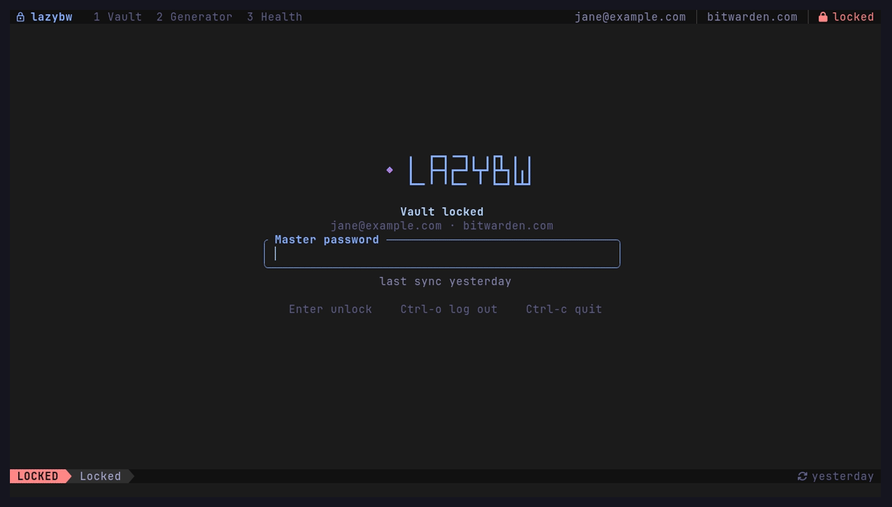
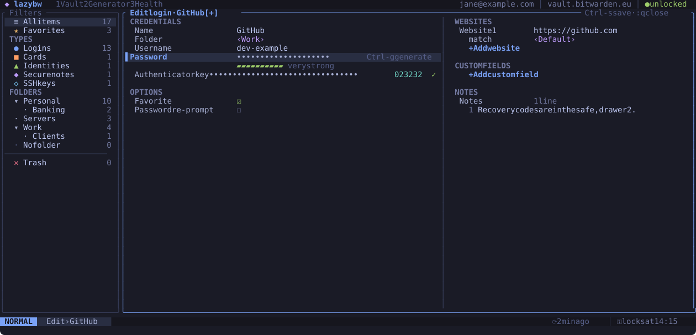
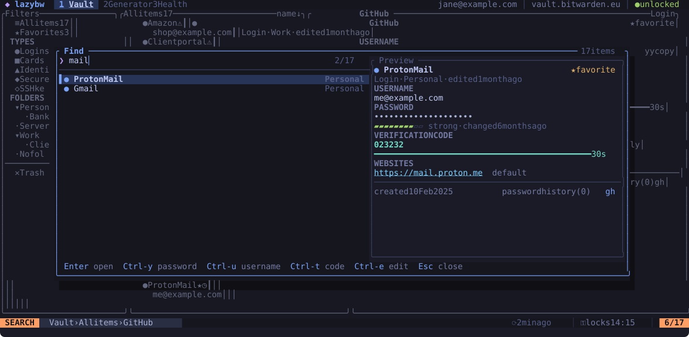
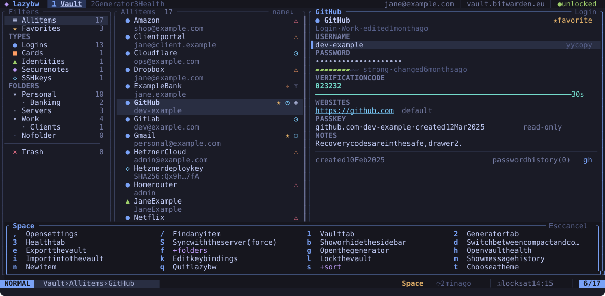
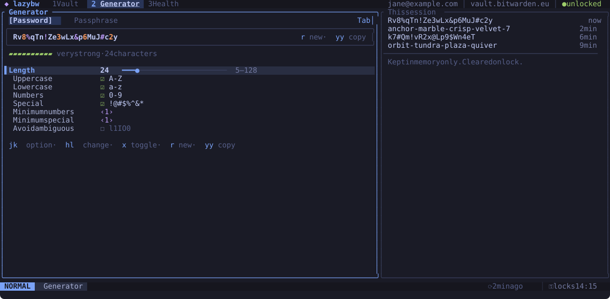
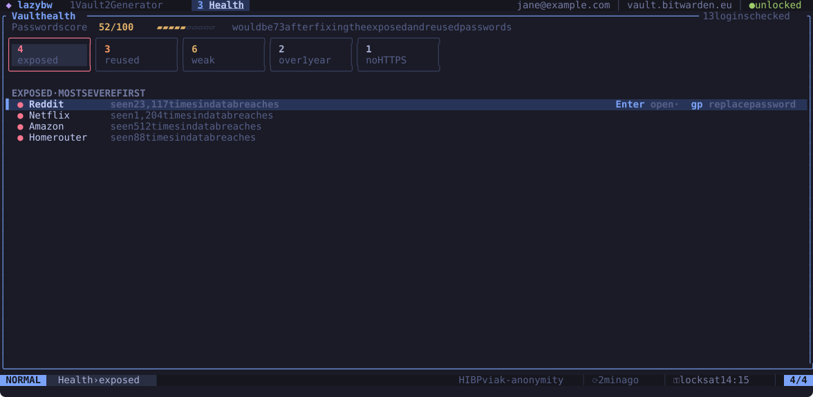
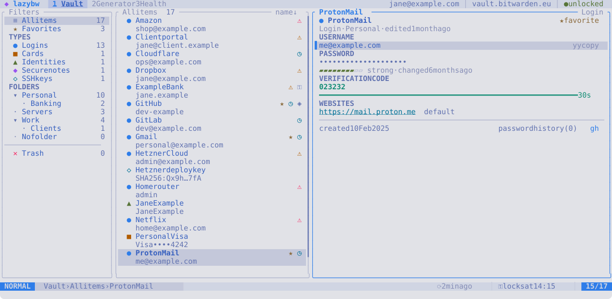

<p align="center">
  
</p>

<p align="center">
  A keyboard-first terminal UI for the Bitwarden vault.
</p>

<p align="center">
  <a href="https://github.com/SyscallBrain/lazybw/actions/workflows/ci.yml"></a>
  <a href="https://github.com/SyscallBrain/lazybw/releases/latest"></a>
  <a href="https://syscallbrain.github.io/lazybw/"></a>
  <a href="LICENSE"></a>
  
</p>

<p align="center">
  <a href="https://syscallbrain.github.io/lazybw/">Documentation</a> ·
  <a href="#install">Install</a> ·
  <a href="#screenshots">Screenshots</a> ·
  <a href="CHANGELOG.md">Changelog</a>
</p>



lazybw lets you browse, search, copy and edit your Bitwarden items without
leaving the terminal, with Vim-style keys. It runs the official Bitwarden
CLI in the background and leaves all vault cryptography to it.

## Features

- Log in with email and password (including two-step login), single sign-on
  or an API key; unlock, lock, sync, and lock automatically when idle.
- Logins, secure notes, cards, identities and SSH keys, browsed by type or by
  nested folder, with fuzzy search, search qualifiers and a `Ctrl-p` finder.
- Copy any field with `y` keys, with configurable clipboard clearing.
  Verification codes are computed locally, so they work without Bitwarden
  Premium.
- A form editor with Vim modes, a built-in password generator, and `$EDITOR`
  for notes or the whole item as JSON.
- Vault health (exposed, reused, weak, old and insecure passwords), export,
  and import with a duplicate review for Bitwarden JSON files.
- Undo and redo for vault changes, visual mode and marks for bulk actions.
- Every key can be rebound. Ten built-in themes, your own themes, and Nerd
  Font, Unicode or ASCII icons.
- Works locally or over SSH, on X11 and Wayland.

## Install

You need Linux on x86_64 or aarch64 and the official
[Bitwarden CLI](https://bitwarden.com/help/cli/) (`bw`) 2025.9.0 or newer
on your `PATH`. A few features need a newer `bw`; the
[installation guide](https://syscallbrain.github.io/lazybw/installation.html)
lists them.

Download the file for your system from the
[latest release](https://github.com/SyscallBrain/lazybw/releases/latest).
x86_64 packages are named `amd64` or `x86_64`, and aarch64 packages `arm64`
or `aarch64`. `SHA256SUMS` lists the checksum of every file.

| System | Install the downloaded file |
|---|---|
| Debian, Ubuntu | `sudo apt install ./lazybw_*_amd64.deb` |
| Fedora, openSUSE, RHEL | `sudo dnf install ./lazybw-*.x86_64.rpm` |
| Arch Linux | `paru -S lazybw-bin` from the AUR, or `sudo pacman -U lazybw-*-x86_64.pkg.tar.zst` |
| Any other Linux | unpack the `.tar.gz` and put `lazybw` on your `PATH` |

There is also a container image with `bw` included. The volume keeps your
login and settings between runs, and copying goes through your terminal
(OSC 52):

```sh
docker run -it --rm -v lazybw:/home/lazybw ghcr.io/syscallbrain/lazybw
```

To build from source you need Rust 1.88 or newer:

```sh
cargo install --git https://github.com/SyscallBrain/lazybw --tag v1.0.0 --locked lazybw
```

Android (Termux) and the other options are covered in the
[installation guide](https://syscallbrain.github.io/lazybw/installation.html).
Then run:

```sh
lazybw doctor   # check that bw, the clipboard and the terminal are found
lazybw          # log in or unlock, then browse
```

## First steps

| Keys | Action |
|---|---|
| `j` `k`, `gg` `G` | move, jump to first or last |
| `/`, `Ctrl-p` | search the list, find anywhere |
| `yu` `yp` `yt` | copy username, password, verification code |
| `za` | reveal the password |
| `a`, `e` | new item, edit item |
| `dd`, `u` | move to trash, undo |
| `Space` | show every leader command |
| `Space l` | lock the vault |
| `q` | quit (in the editor: close the item) |
| `?` | help for the current screen |

## Screenshots

The demo and the screenshots use a sample vault with fictional data.

| | |
|---|---|
|  |  |
| The editor, with Vim modes and two columns | `Ctrl-p` finds and copies from anywhere |
|  |  |
| `Space` shows every command that can follow | Passwords and passphrases, with history |
|  |  |
| Exposed, reused, weak and old passwords | Ten built-in themes, light and dark |

## Security

lazybw delegates vault cryptography and communication with Bitwarden
servers to the official Bitwarden CLI. By default it talks to `bw serve`
through a private socket pair, so no network port is opened. lazybw handles
decrypted vault data while the vault is unlocked; the
[security chapter](https://syscallbrain.github.io/lazybw/security.html)
describes how it protects that data and where the limits are.

To report a vulnerability, follow the private reporting instructions in
[SECURITY.md](SECURITY.md).

## Contributing

Bug reports, feature suggestions and pull requests are welcome. See
[CONTRIBUTING.md](CONTRIBUTING.md) for setup and [ARCHITECTURE.md](ARCHITECTURE.md)
for how the code is organised. From the root of a clone:

```sh
scripts/check.sh   # format, lints and the whole test suite
```

The tests run against `crates/fake-bw`, a stand-in for the Bitwarden CLI, and
never touch a real vault.

## License

[MIT](LICENSE) © Tiago Correia

lazybw is an independent project, not affiliated with or endorsed by
Bitwarden, Inc.
