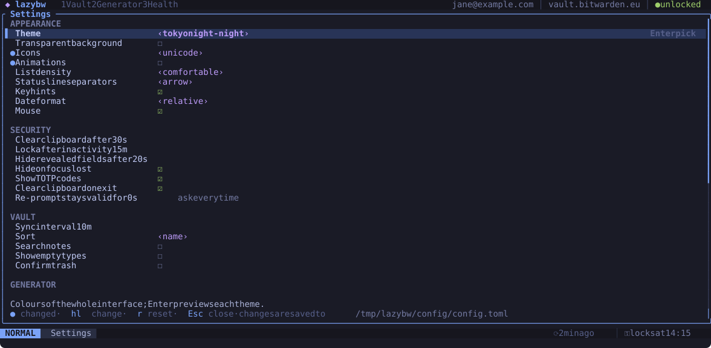

# Configuration

lazybw reads `~/.config/lazybw/config.toml`. The file is optional: without
it, lazybw uses the defaults listed in
[Default configuration](reference/config.md). Put in it only the options you
want to change.

```toml
[ui]
theme = "catppuccin-mocha"
icons = "unicode"

[security]
clipboard_timeout = "20s"
auto_lock = "10m"

[vault]
sort = "modified"
```

Durations are written as `"500ms"`, `"30s"`, `"15m"`, `"2h"` or `"365d"`.
Options that can be switched off also accept `"never"`.

## Changing settings from inside lazybw



`Space` `,` opens the settings screen. Move with `j` and `k`, change a value
with `h` and `l` (or `Enter`), and reset it to the default with `r`. The line
at the bottom explains the selected option, and a `●` marks the ones you have
changed from the default. Changes
take effect at once and are written back to `config.toml`, keeping your
comments and the order of the file.

The same works from the command line:

```text
:set theme=nord            set a value
:set animations!           toggle a true/false option
:set clipboard_timeout?    show the current value
:set animations&           back to the default
```

Short names work when they are unambiguous. The full name, such as
`ui.animations`, always works.

## Checking the file

```sh
lazybw config --check          # validate config.toml
lazybw config --path           # print where it is
lazybw config --print-default  # print the full default file
```

lazybw also checks the file on start. A mistake, such as a wrong value or a
typo in a key binding, opens an error screen that names the file, the line
and what is wrong. Unknown keys only produce a warning.

## The options most people change

| Option | Default | What it does |
|---|---|---|
| `ui.theme` | `"tokyonight-night"` | colour theme (see [Themes and icons](themes.md)) |
| `ui.icons` | `"nerdfont"` | `nerdfont`, `unicode` or `ascii` |
| `ui.animations` | `true` | small fades and slides when panes and popups open |
| `ui.list_density` | `"comfortable"` | two lines per item, or `compact` for one |
| `ui.mouse` | `true` | mouse support |
| `security.clipboard_timeout` | `"30s"` | when copied values are cleared |
| `security.auto_lock` | `"15m"` | lock after this long without a key press |
| `security.reveal_timeout` | `"20s"` | when revealed values hide again |
| `security.reprompt_grace` | `"0s"` | how long a correct master password re-prompt counts |
| `vault.sync_interval` | `"10m"` | background sync |
| `vault.sort` | `"name"` | `name`, `modified`, `created` or `type` |
| `vault.search_notes` | `false` | let search look inside notes |
| `vault.confirm_trash` | `false` | ask before `dd` moves an item to the trash |
| `editor.command` | `""` | editor for `Ctrl-e`; empty means `$VISUAL`, then `$EDITOR`, then `vi` |
| `keys.leader` | `"<Space>"` | the leader key |
| `keys.timeoutlen` | `"1000ms"` | how long lazybw waits to see if a sequence continues |

## Using a different `bw`

lazybw looks for `bw` in `bw.path` first, then in the `LAZYBW_BW` environment
variable, then on your `PATH`. Set `bw.path` if you keep several versions.

By default lazybw ignores a `BW_SESSION` variable in the environment and asks
you to unlock. Set `bw.inherit_session = true` to reuse an existing session
instead.
