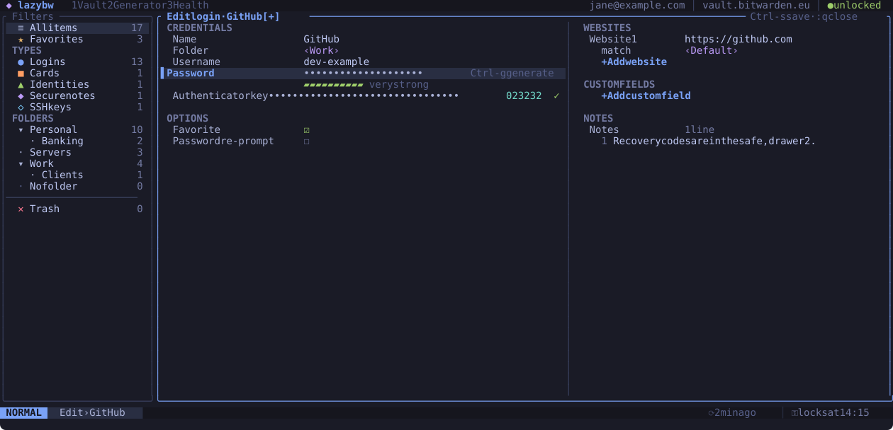

# Editing items

## Creating an item

Press `a` in the list. A small menu asks for the type: `l` login, `n` secure
note, `c` card, `i` identity or `s` SSH key. The new item starts in the
folder you are looking at.

## Opening the editor

`e` (or `i`) on an item opens it in the editor. The form replaces the list and
detail panes. On a wide terminal it has two columns: credentials and options
on the left, websites, custom fields and notes on the right.

The editor works like Vim, with two modes.

In NORMAL mode you move between fields:

- `j` and `k` go down and up. They walk the whole left column first, then the
  right one.
- `h` and `l` jump to the other column, to the field at the same height.
- `gg` and `G` go to the first and last field.

In INSERT mode you type into the field under the cursor:

- `i` starts typing at the cursor, `a` after it, `I` at the start and `A` at
  the end.
- `cc` (or `S`) clears the field and starts typing.
- `Esc` goes back to NORMAL.
- `Tab` and `Shift-Tab` move to the next and previous field without leaving
  INSERT.

Inside a field you have the usual editing keys: `Backspace`, `Delete`, the
arrows, `Home`, `End`, `Ctrl-w` to delete a word and `Ctrl-u` to delete to
the start. Pasting works as well.

## Fields with choices

Some fields offer a fixed set of values, like the folder, a card's brand or a
website's match type. `Ctrl-a` and `Ctrl-x` step through the choices, and
`Enter` opens a list to pick from. Checkboxes such as Favorite toggle with
`Enter`.

## Lists of websites and custom fields

On a website or custom field, `o` adds a new one below and `O` above, and
`dd` removes it. The "+ Add website" and "+ Add custom field" rows do the same
with `Enter`.

## Generating a password

`Ctrl-g` opens the password generator over the form. Adjust the options as on
the [generator tab](generator.md), press `r` for another password, then
`Enter` to put it in the password field, or `Esc` to cancel. If the cursor is
on another hidden field, the password goes there instead.

## Using your own editor

`Ctrl-e` opens the notes in `$VISUAL` or `$EDITOR` (or the command in
`editor.command`). Save and quit the editor to bring the text back into the
form. On an SSH key's private key field, `Ctrl-e` edits the key instead, and
lazybw checks that what you saved is a valid key.

`gE` opens the whole item as JSON, for changes the form cannot make. From the
list, the edited item opens in the editor afterwards, so you can review it
before `Ctrl-s` saves it (or `ZQ` drops it). In the editor, `:e!` throws the
changes away and loads the item again from Bitwarden.

The text is written to a temporary file in `$XDG_RUNTIME_DIR/lazybw`, readable
only by you, and lazybw overwrites and deletes it as soon as the editor
exits. For Vim, Neovim, Emacs and micro, lazybw also switches off swap,
undo, backup and history files, so no copy of the secret is left elsewhere on
disk.

## Saving and closing

| Keys | Does |
|---|---|
| `Ctrl-s` or `:w` | save and stay in the editor |
| `ZZ` or `:wq` | save and close |
| `q`, `Esc` or `:q` | close; asks first if there are unsaved changes |
| `ZQ` or `:q!` | close and throw the changes away |

When there are unsaved changes, closing asks "Save changes to …?". Answer `y`
to save, `n` to discard or `c` to stay in the editor. The title shows `[+]`
while the item has unsaved changes.

`u` undoes the last change and `Ctrl-r` redoes it. As in Vim, everything you
type between `i` and `Esc` counts as one change. When you undo back to the
last saved state, the `[+]` disappears. `:e!` reloads the item as it is on the
server.

Each save is also one step in the vault's undo history: after closing the
editor, `u` in the list puts the item back as it was before the save.

If someone changes the same item elsewhere (in the browser extension, for
instance) while you edit it, lazybw shows a banner. Saving then keeps your
version.
