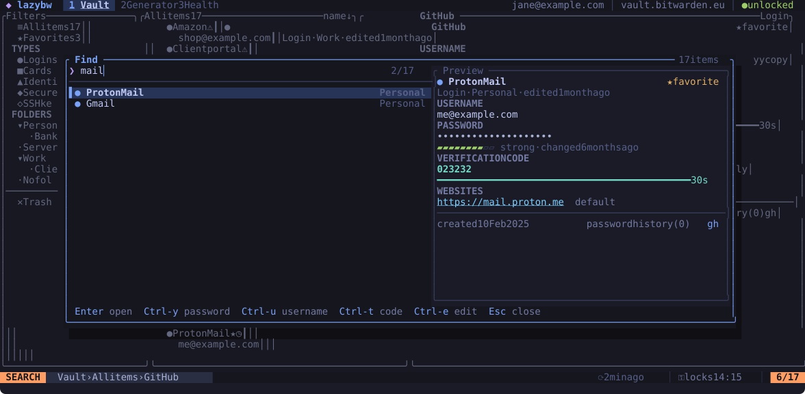

# Finding items

## Filters

Pick a filter in the left pane with `Enter`: all items, favourites, one item
type, a folder, items without a folder, or the trash. The list title shows
which filter is active and how many items it holds, for example
`Finanças › Bancos 7`.

`Space` `s` changes the sort order. It is followed by `n` (name), `m`
(modified), `c` (created) or `t` (type), and `Space` `s` `r` reverses the
order.

## Search

`/` searches inside the current filter. The list narrows as you type, `Enter`
keeps the result and returns to the list, and `n` and `N` jump to the next and
previous match. `Esc` clears the search.

The search is fuzzy, so `gthb` finds GitHub. It looks at the item name first,
then the username, the website hosts and the names of custom fields. Set
`vault.search_notes = true` to search inside notes as well.

You can narrow the search with qualifiers:

| Qualifier | Matches |
|---|---|
| `type:login` (or `l`, `note`, `card`, `identity`, `ssh`) | one item type |
| `folder:work/proj` | folders whose path starts with this; `folder:none` for items without one |
| `is:fav`, `is:trash`, `is:reprompt` | favourites, trashed items, items that ask for the master password |
| `is:weak`, `is:reused`, `is:exposed`, `is:old`, `is:insecure` | results of the last health check |
| `has:totp`, `has:passkey`, `has:fields`, `has:notes`, `has:uri` | items with that kind of data |
| `uri:google`, `user:alice`, `name:bank` | text inside one field |

Put `-` in front of a word or qualifier to exclude it, and quotes around a
phrase with spaces. A few examples:

```text
git -type:note
has:totp folder:work
is:reused uri:google
"home router"
```

## Quick open



`Ctrl-p` (or `Space` `/`) opens a finder over the whole vault, wherever you
are. Type a few letters and act on the match without leaving the finder:

| Keys | Does |
|---|---|
| `Enter` | open the item |
| `Ctrl-y` | copy the password |
| `Ctrl-u` | copy the username |
| `Ctrl-t` | copy the verification code |
| `Ctrl-e` | edit the item |
| `Ctrl-n` / `Ctrl-p` | next / previous match |

Quick open uses the same search language as `/`. It leaves trashed items out
unless you add `is:trash`.

## Jumping back

lazybw remembers where you have been. `Ctrl-o` goes back to the previous item
or filter and `Ctrl-i` goes forward again. `gf` jumps to the folder of the
item under the cursor.
