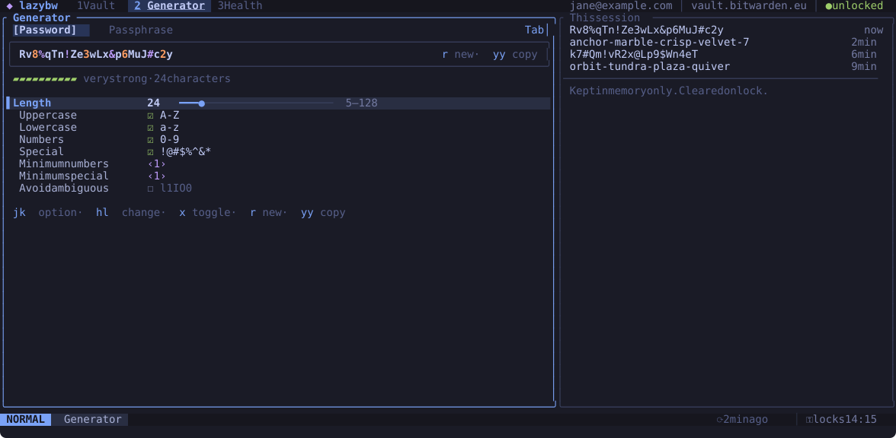

# Password generator

The second tab (`Space` `2`, or `Space` `g`) generates passwords and
passphrases with Bitwarden's own generator.

## Options

`Tab` switches between Password and Passphrase. Move between the options with
`j` and `k`:

- A password has a length (5 to 128) and four character sets: upper case,
  lower case, digits and symbols. You can ask for a minimum number of digits
  and symbols, and leave out characters that are easy to confuse (`l`, `1`,
  `I`, `O`, `0`).
- A passphrase has a number of words (3 to 20), a separator, and options to
  capitalise the words and add a number.

`h` and `l` (or `-` and `+`) change numbers and choices, and `x` turns a
checkbox on or off. Every change makes a new password. `r` makes another one
with the same options.

The strength bar under the password estimates how hard it would be to guess.

## Using the password

`yy` copies it. `Enter` puts it into the login you have selected in the vault,
after asking you to confirm. Bitwarden keeps the old password in the item's
password history (the last five).

To generate a password while editing an item, press `Ctrl-g` in the editor
(see [Editing items](editing.md#generating-a-password)).

## History

The right pane lists the passwords generated in this session, newest first.
The list exists only in memory and is wiped when the vault locks or lazybw
exits.

## Defaults

The `[generator]` section of the [configuration](configuration.md) sets the
options lazybw starts with. Changes you make on the tab last until you quit.

From the command line, `:gen 32` generates and copies a 32-character password,
and `:gen phrase 6` a six-word passphrase.
