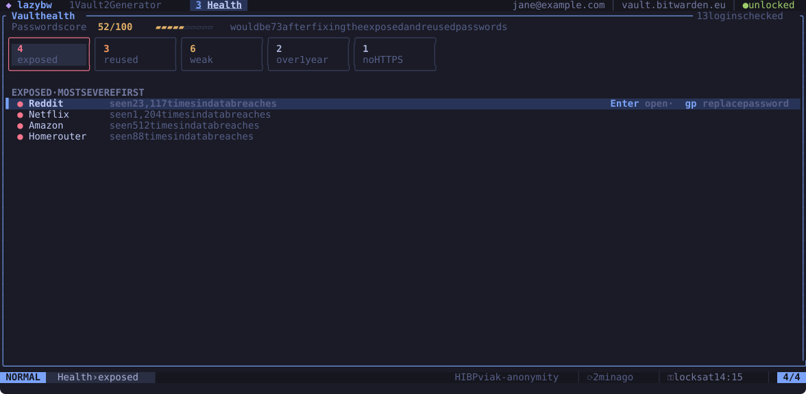

# Vault health

The third tab (`Space` `3`, or `Space` `h`) checks your logins and tells you
which passwords to change first.

## The report

At the top is a password score from 0 to 100 and, next to it, the score you
would get after fixing the exposed and reused passwords. The score sums up
the logins lazybw checked; it is not a rating of your whole account. Under it
are five categories (cards on a wide terminal, a compact row on a narrow
one):

| Category | Means |
|---|---|
| Exposed | the password appears in known data breaches |
| Reused | the same password is used by more than one item |
| Weak | the password is easy to guess |
| Old | the password has not changed for a year (`health.old_password_age`) |
| No HTTPS | a website of the login uses plain `http://` |

`Tab` and `Shift-Tab` move between the cards, and the list below shows the
logins in that category, most serious first. For exposed passwords it shows
how many times each one was seen in breaches.

| Keys | Does |
|---|---|
| `Enter` | open the item in the vault |
| `e` | edit the item |
| `gp` | generate a new password for it and save it in the vault (after confirming) |
| `r` | run the check again |

`gp` only changes the password stored in the vault. Change it on the website
as well, or the account keeps the old one.

After a check, the vault list marks affected items with a warning sign, and
you can search for them with `is:weak`, `is:reused`, `is:exposed`, `is:old`
and `is:insecure`.

## How the breach check works

With `bw` 2026.8.0 or newer, lazybw runs `bw report password-health`. To find
exposed passwords, `bw` asks the Have I Been Pwned service using
k-anonymity: it sends only the first five characters of each password's SHA-1
hash and compares the answers locally. Your passwords never leave your
machine.

If you would rather not contact Have I Been Pwned at all, set
`health.check_exposed = false`. The Exposed card then shows a dash.

With an older `bw`, lazybw does the other checks itself and skips the breach
lookup.
