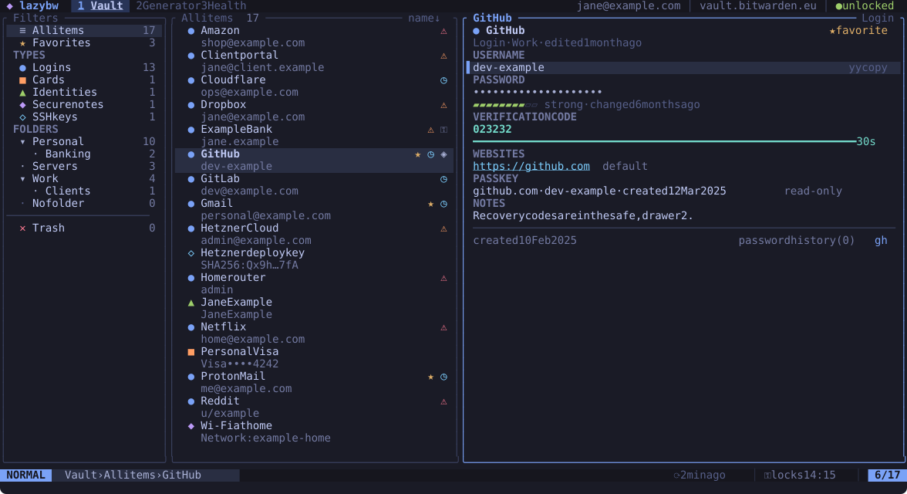

lazybw is a terminal interface for your [Bitwarden](https://bitwarden.com)
vault. You browse, search, copy and edit items with the keyboard, the way you
would move around in Vim or lazygit, and you never leave the terminal.

It runs on top of the official Bitwarden command-line client, `bw`. lazybw
starts `bw serve` in the background and talks to it over a private channel,
so all encryption and decryption happen in Bitwarden's own code. lazybw only
draws the screen and sends requests.

## What you can do with it

- Log in (email and password with two-step login, single sign-on or an API
  key), unlock, lock and sync.
- Browse logins, secure notes, cards, identities and SSH keys by type or by
  folder, and find any item with fuzzy search.
- Copy usernames, passwords and verification codes. The clipboard clears
  itself after 30 seconds.
- Create and edit items in a form, or open the notes (or the whole item as
  JSON) in your `$EDITOR`.
- Generate passwords and passphrases, check the vault for weak, reused or
  exposed passwords, and import or export the vault.
- Change every keybinding, pick one of ten themes or write your own.

## Who it is for

lazybw is for people who already live in a terminal and use Bitwarden. If you
like Vim motions, you will feel at home within minutes. If you don't, the
arrow keys work too, and `?` shows the keys for the screen you are on.

It runs on Linux, locally or over SSH, under X11 or Wayland.

## How this book is organised

[Getting started](installation.md) covers installation and the first login.
[Using lazybw](moving-around.md) goes through the daily tasks one by one.
[Making it yours](configuration.md) explains the configuration file, the
keybindings and the themes. The last chapters describe how lazybw protects
your data and list every key, option and command.
