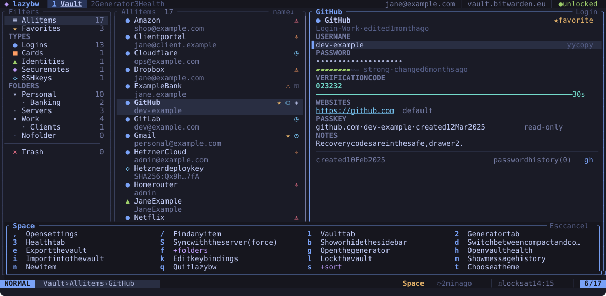

# Moving around

lazybw uses Vim's keys. If you know Vim, most of this page will be familiar.

## Basic movement

| Keys | Moves |
|---|---|
| `j` / `k` (or the arrow keys) | down / up one row |
| `gg` / `G` | to the first / last row |
| `Ctrl-d` / `Ctrl-u` | half a page down / up |
| `Ctrl-f` / `Ctrl-b` | a page down / up |
| `H` / `M` / `L` | to the top / middle / bottom of the visible rows |
| `zz` / `zt` / `zb` | scroll so the cursor sits in the middle / top / bottom |
| `h` / `l` | focus the pane to the left / right |
| `Tab` / `Shift-Tab` | focus the next / previous pane |

A number before a motion repeats it: `5j` moves five rows down and `12G` goes
to the twelfth item. A few actions take a count too, so `3dd` moves three
items to the trash. The page motions move by the height of the list on
screen, and the mouse wheel scrolls the pane under the pointer.

## Typing in a field

The command line, search, quick open, the prompts and the editor's fields
share the keys of a shell: the arrows, `Home` and `End` move, `Backspace` and
`Delete` delete, `Ctrl-w` deletes the word before the cursor and `Ctrl-u`
everything before it. In a password field `Ctrl-u` clears what you typed.

## The leader key

Many commands start with the leader key, which is `Space` unless you change
it. `Space` `g` opens the generator, `Space` `l` locks the vault, and so on.
In this book the leader is written as `Space`.

## Which-key

Press `Space` and wait a moment. A panel opens above the status line with
every key that can follow, each with a short description. Groups that lead
to more keys are marked with a `+`, such as `+folders` behind `Space` `f`.
The panel stays open until you press a key, and `Esc` cancels.

The same panel appears for the other prefixes: `g`, `z`, `y` and `d`.

If you type a sequence that does not exist, such as `z` followed by a key
that has no meaning after `z`, lazybw drops the whole sequence and does
nothing. It never runs the second key on its own.

## Help

`?` opens the help for the screen you are on, grouped by context. Press `/`
to search it, and `q` or `Esc` to close it.

## Mouse

Clicking selects panes, rows and tabs, the wheel scrolls, and dragging a
pane border resizes it. Set `ui.mouse = false` if you would rather the
terminal kept the mouse for selecting text.

## Redrawing the screen

If something ever leaves garbage on the screen, `Ctrl-l` repaints all of it.
