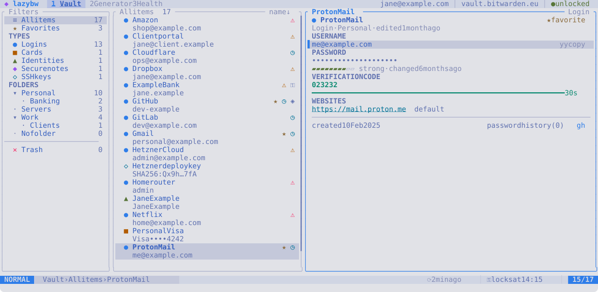

# Themes and icons

## Built-in themes



| Theme | Style |
|---|---|
| `tokyonight-night` (default) | dark |
| `tokyonight-storm` | dark |
| `tokyonight-moon` | dark |
| `tokyonight-day` | light |
| `catppuccin-mocha` | dark |
| `gruvbox-dark` | dark |
| `nord` | dark |
| `rose-pine` | dark |
| `kanagawa-wave` | dark |
| `terminal` | uses your terminal's own colours |

`Space` `t` opens a picker with the built-in themes and your own. The screen
changes to each theme as you move through the list; `Enter` keeps it, also
for the next start (it is written to `ui.theme` in the configuration), and
`Esc` goes back to the one you had. `:theme` followed by `Tab` previews the
same way, and `:theme nord` switches directly; both last until you quit,
which is handy for trying one out. `:set theme=nord` switches and keeps it.

`lazybw themes` lists them, and `lazybw themes --preview nord` prints a
theme's colours.

With `ui.transparent = true`, lazybw leaves the background to the terminal,
which suits terminals with a background image or blur. Popups keep a solid
background so they stay readable.

## Your own theme

Put a file in `~/.config/lazybw/themes/`, for example `my-night.toml`:

```toml
name = "my-night"
extends = "tokyonight-night"   # start from an existing theme
appearance = "dark"            # dark or light

[palette]
accent = "#bb9af7"

[tokens]
"border.focus" = "magenta"
"match" = "#ff9e64"
```

Then set `ui.theme = "my-night"`. lazybw reloads the theme when you save the
file, so you can tweak it with lazybw open.

A theme has two layers:

- The `palette` holds named colours: `bg`, `bg_dark`, `bg_highlight`,
  `bg_visual`, `border`, `fg`, `fg_dark`, `comment`, `dark5`, `accent`,
  `blue`, `cyan`, `magenta`, `purple`, `orange`, `yellow`, `green`, `teal`,
  `red` and `shadow`.
- The `tokens` say which colour each part of the interface uses. A token can
  point to a palette name, a `#rrggbb` colour, an ANSI colour number, or
  `reset` for the terminal's default.

Useful tokens:

| Token | Colours |
|---|---|
| `bg`, `bg.bar`, `bg.float` | main background, top and bottom bars, popups |
| `selection`, `bg.highlight` | the selected row, highlighted rows and segments |
| `border`, `border.focus` | pane borders, the focused one |
| `fg`, `fg.alt`, `fg.muted`, `fg.subtle` | text from strongest to faintest |
| `accent` | titles, focus and the selection bar |
| `ok`, `info`, `caution`, `warn`, `error` | messages and states |
| `type.login`, `type.card`, `type.identity`, `type.note`, `type.ssh` | item icons |
| `match`, `link`, `fav`, `dirty` | search matches, websites, favourites, `[+]` |
| `mode.normal`, `mode.insert`, `mode.visual`, `mode.command` | the mode label |

The built-in themes are in `crates/lazybw/assets/themes/` in the repository
and make good starting points.

On terminals without 24-bit colour, lazybw converts every colour to the
closest of the 256 standard ones. If colours look wrong, check that
`COLORTERM` is set to `truecolor` in a terminal that supports it.

## Icons

`ui.icons` chooses the symbols:

- `nerdfont` (default) uses icons from a [Nerd Font](https://www.nerdfonts.com).
  Install one and select it in your terminal.
- `unicode` uses ordinary symbols such as `●`, `★` and `▸`, which most fonts
  have.
- `ascii` uses only plain characters, for the most limited terminals.
